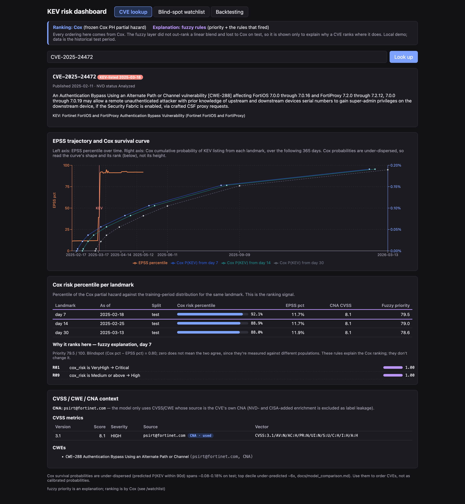
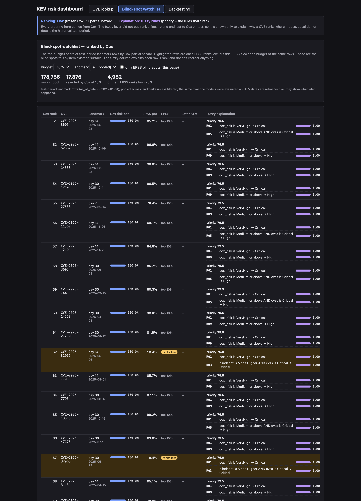

# Beyond EPSS: predicting time to CISA KEV listing with survival analysis

This project asks a narrow, practical question. **When a new CVE appears, can
public threat intelligence tell us early which ones CISA will add to its Known
Exploited Vulnerabilities (KEV) catalog, and roughly when?** It also asks whether
that beats simply ranking by EPSS, the FIRST Exploit Prediction Scoring System.

It is an end-to-end pipeline:

- **Data:** NVD, EPSS, CISA KEV, Exploit-DB and MITRE CWE are ingested into a
  versioned PostgreSQL warehouse.
- **Dataset:** a leakage-audited survival dataset is built at fixed landmarks after
  publication.
- **Models:** three survival models (Cox PH, Random Survival Forest, XGBoost-AFT)
  are compared against EPSS-alone, with a paired bootstrap on identical test rows.
- **Serving:** the frozen models are served through a read-only API and a local
  dashboard.

> **Headline result.** On CVEs published from 2025-01-01 (178,756 landmark rows,
> 268 KEV events), a Cox model ranks future KEV listings better than EPSS-alone:
> C-index **0.850 vs 0.750**, paired Δ **+0.100 (95% CI +0.069, +0.139)**. At a
> 10% alert budget it catches **63% of listings vs 46%**. EPSS-alone needs about
> **2.3× the triage effort** to match Cox's recall. Cox's advantage is
> **coverage, not earliness**: it catches 19 of the 52 listed CVEs that EPSS never
> flags, a median of 48 days before listing. On CVEs both flag, they flag at the
> same time.

Every number in this README comes from [`docs/final_results.md`](docs/final_results.md),
the single authoritative source. All test-set numbers there come with 95% bootstrap
CIs.

---

## Contents

1. [The prediction task](#the-prediction-task)
2. [Data sources](#data-sources)
3. [Design](#design)
4. [Leakage controls](#leakage-controls)
5. [Results](#results)
6. [Limitations](#limitations)
7. [Repository layout](#repository-layout)
8. [Setup](#setup)
9. [Running the pipeline](#running-the-pipeline)
10. [API and dashboard](#api-and-dashboard)
11. [Tests](#tests)
12. [Documentation map](#documentation-map)

---

## The prediction task

- **Event:** the CVE's `dateAdded` in the CISA KEV catalog.
- **Landmarks:** 62% of KEV listings happen within 30 days of publication, so a
  single day-30 snapshot would throw most events away. Instead the model predicts
  at **landmarks 7, 14 and 30 days after publication**.
- **Rows:** at each landmark, every CVE that is still unlisted (and has an EPSS
  score) becomes one row. The question for that row is: *how long until this CVE
  is KEV-listed, if ever?* A CVE contributes up to 3 rows.
- **Labels:** right-censored survival labels (`event_time`, `event_observed`).
  Most CVEs are never listed; the event rate is about 0.15% of rows.
- **Use:** the output is a **ranking** for triage. The evaluation therefore leads
  with C-index and **Recall@k%**, the share of all KEV events that land in the top
  k% of rows. The ranking's cumulative probabilities are under-dispersed and are
  not calibrated risk (see [Limitations](#limitations)).

## Data sources

| Source | What it provides | Used for |
|---|---|---|
| [NVD API 2.0](https://nvd.nist.gov/developers) | CVE records, CVSS metrics, CWE mappings, CPEs, and each record's own CNA (`sourceIdentifier`) | Publication-time features (own-CNA only, see below) |
| [FIRST EPSS](https://www.first.org/epss/) | Daily EPSS score and percentile for every CVE, across EPSS model versions | Current EPSS level, trajectory features, and the EPSS-alone baseline |
| [CISA KEV](https://www.cisa.gov/known-exploited-vulnerabilities-catalog) | The catalog and each entry's `dateAdded` | The event label |
| [Exploit-DB](https://gitlab.com/exploit-database/exploitdb) | Public exploit index with publication dates | "Public exploit by landmark" features |
| [MITRE CWE](https://cwe.mitre.org/) | Weakness catalog | CWE normalization and target encoding |

The backfill covers 2021-11-01 → 2026-09-20 (dataset version `landmark_v20260922`).
A resumable, idempotent refresh to 2026-10-21 (`scripts/download/refresh.py`) adds
the data for the 2026 holdout cohort.

The warehouse has four schemas: `staging` (raw payloads plus a file manifest with
checksums), `canonical` (cleaned, normalized tables), `features` and `training`.

## Design

**Split.**

| Split | CVEs | Labels | Rows / CVEs / events |
|---|---|---|---|
| Train | published before 2025-01-01 | censored at 2025-01-01 (later listings were unknowable then) | 268,944 / 92,141 / 441 |
| … validation (inside train) | published 2024-07-01 … 2024-12-31 | as train | 53,674 / 18,973 / 55 |
| Test | published 2025-01-01 … 2026-03-24 | observed to 2026-09-20 | 178,756 / 60,962 / 268 |

- **Tuning:** hyperparameters are chosen on fit/validation only. Fit labels are
  re-censored at 2024-07-01, so validation-period listings cannot leak into fit.
- **Final fit:** the chosen configuration is refit once on the full train set and
  frozen (`models/`).
- **Test:** test is touched only to evaluate the frozen models.

**Features (23)**, each computed strictly *as of* the landmark date:

- **EPSS (8):** percentile now, 7 days ago (plus a missing flag), 7-day delta,
  first percentile, max to date, days to first score, and the EPSS model version in
  force.
- **Severity (10):** CVSS base score and the eight vector components plus version,
  taken only from the CVE's own CNA, and a `cvss_cna_missing` flag.
- **Target encodings (2):** expanding-window KEV rates by CWE and by CNA, using only
  listings known before the landmark.
- **Exploits (2):** public exploit published by the landmark, and days to first
  exploit.
- **Landmark (1):** the landmark day itself.

The exact allowlist is `MODEL_FEATURE_COLUMNS` in
`scripts/features/build_landmark_dataset.py`. A test enforces it, together with a
list of banned columns.

**Models.**

- **Cox PH** (lifelines, penalizer 0.1, no tuning step): the ranking model.
- **Random Survival Forest** (scikit-survival) and **XGBoost-AFT**: tuned on
  validation.
- **Fuzzy rule layer** (`scripts/fuzzy/`): designed on validation, used only to
  *explain* Cox's ranking in plain terms (which rules fired, and how strongly).

**Evaluation.** Every comparison goes through one shared module,
`scripts/evaluate/common.py`: the same test rows, seed (20260922) and **200
whole-CVE bootstrap resamples**, with *paired* differences computed on each
resample. One-off bootstrap loops are not allowed (see `CLAUDE.md`).

## Leakage controls

This dataset can leak the label in subtle ways. Each of the controls below came from
a concrete finding.

1. **Temporal as-of rule.** Every feature reads only data dated on or before the
   row's `as_of_date`. No row exists for a CVE already listed by its landmark.
   Tests in `tests/test_leakage/` verify this against independent SQL.
2. **Enrichment (selection) leakage.**
   - **The finding:** 100% of KEV-listed CVEs had NVD status `Analyzed`, against
     19–50% of the rest. NVD's analysts enrich prioritized CVEs, and the enrichment
     itself (NVD's own CVSS, CWE and CPE/vendor data) is a proxy for "someone
     already thinks this matters".
   - **The fix:** a CVSS metric or CWE mapping is used **only if its `source` is the
     CVE's own CNA (`sourceIdentifier`)**. Vendor/product features were dropped
     entirely.
   - **ADPs excluded:** the first version of the rule still admitted CISA's
     Vulnrichment ADP. CISA runs KEV, so that is circular, and the rule was
     tightened.
   - **Write-up:** [`docs/enrichment_leakage.md`](docs/enrichment_leakage.md).
3. **EPSS model-version transitions.** Rows whose 7-day window spans an EPSS model
   release are flagged and excluded by default. The release dates are 2022-02-04,
   2023-03-07, 2025-03-17 and 2026-06-15. A sensitivity analysis adds them back.
4. **No surrogate-ID ordering.** Any "pick one row per CVE" step sorts on data
   values, never on database serial IDs. A test fails if a feature-path module
   references a surrogate ID column.
5. **Holdout isolation.** The 2026 holdout cohort (`training.holdout_2026`) is
   enforced disjoint from `training.training_dataset` by database constraint
   triggers in both directions.

## Results

All numbers are on the 2025+ test set: frozen models, 95% CIs from 200 whole-CVE
resamples. **Bold** paired differences exclude zero.

### Model comparison

| Model | C-index | Recall@1% | Recall@5% | Recall@10% | Blind-spot catch @10% |
|---|---|---|---|---|---|
| **Cox** | **0.850** (0.810–0.887) | 0.231 (0.149–0.298) | 0.496 (0.398–0.591) | **0.631** (0.529–0.718) | 0.338 (0.210–0.458) |
| RSF | 0.812 (0.757–0.854) | 0.287 (0.214–0.366) | 0.504 (0.414–0.578) | 0.582 (0.482–0.667) | 0.379 (0.253–0.506) |
| XGBoost-AFT | 0.785 (0.734–0.825) | 0.231 (0.165–0.315) | 0.425 (0.330–0.504) | 0.504 (0.413–0.592) | 0.428 (0.297–0.545) |
| EPSS-alone | 0.750 (0.687–0.804) | 0.190 (0.130–0.251) | 0.369 (0.282–0.469) | 0.459 (0.374–0.544) | 0 (by definition) |

*Blind-spot catch:* the share of KEV events outside EPSS's top 10% that a model
puts in its own top 10%.

**Paired against EPSS-alone:**

| Model | ΔC-index | ΔRecall@1% | ΔRecall@5% | ΔRecall@10% |
|---|---|---|---|---|
| Cox | **+0.100 (+0.069, +0.139)** | +0.041 (−0.022, +0.095) | **+0.127 (+0.055, +0.184)** | **+0.172 (+0.095, +0.236)** |
| RSF | **+0.062 (+0.003, +0.124)** | **+0.097 (+0.036, +0.157)** | **+0.134 (+0.049, +0.231)** | **+0.123 (+0.028, +0.234)** |
| XGBoost-AFT | +0.035 (−0.029, +0.105) | +0.041 (−0.043, +0.128) | +0.056 (−0.040, +0.150) | +0.045 (−0.066, +0.161) |


### What else the evaluation found

- **Budget equivalence.** To match Cox's recall, EPSS-alone needs a **10.8%**
  budget where Cox uses 5% (2.2×, CI 1.3–2.9×), and **23.5%** where Cox uses 10%
  (2.3×, CI 1.8–3.7×). At a 1% budget there is no significant difference.
- **Time-dependent AUC.** Cox beats raw EPSS at 30, 90 and 180 days, pooled and at
  every landmark. Pooled ΔAUC is +0.114 to +0.119, all excluding zero.
- **Rolling origin.** Refitting Cox at cutoffs 2024-01, 2024-07, 2025-01 and
  2025-07 and testing on the following 6 months: Cox beats EPSS on C-index and
  Recall@10% in **every fold**. Recall@1% is not consistent.
- **Lead time (descriptive).** Of the 108 listed test CVEs, both models flag 54,
  and on 51 of those they flag at the same landmark. **Cox alone flags 19 that
  EPSS never flags** (median 48 days before listing); EPSS alone flags 2.
- **Trajectory hypothesis (H1) rejected.** Adding EPSS *trajectory* features to
  the current EPSS level gives no measurable benefit: ΔC-index −0.0055
  (−0.0147, +0.0049). EPSS's current level does carry signal.
- **Fuzzy layer.** It beats EPSS but is no better than a linear blend of its
  inputs, and is worse than Cox at Recall@10%. It is therefore used to *explain*
  the ranking, not to produce it.
- **Robustness.** Adding back version-transition rows, dropping the VulnCheck CNA,
  or keeping only CVEs with a CNA CVSS score leaves Cox's advantage intact in every
  case.

### Corrected-label record

Six test CVEs were added to KEV after the catalog snapshot the dataset was built
from (18 rows). [`docs/results_corrected_labels.md`](docs/results_corrected_labels.md)
recomputes every test metric with those labels corrected, beside the recorded value.

- **Unchanged conclusions:** Cox − EPSS ΔC-index becomes +0.116 (+0.081, +0.156),
  and the 10% effort ratio is 2.37×.
- **Intervals that cross their null:** 5 secondary intervals, all listed in that
  file.
- **The original record is kept:** `docs/final_results.md` is unchanged.

## Limitations

The full list is in `docs/final_results.md` § Limitations. The most important:

- **Probabilities are not calibrated.** Cox's predicted risks are under-dispersed;
  the top decile is under-predicted about 6×. Recalibrating on validation (isotonic
  and Platt) failed on test. **Use the output for ordering only.**
- **Small event counts.** There are 268 test events and 55 validation events.
  Recall CIs are about ±0.1, so differences of a few points are mostly noise.
- **Residual enrichment bias.** Even with the own-CNA rule, CNA-CVSS presence
  differs between listed and unlisted CVEs: −2.76pp on train and +6.23pp on test,
  in opposite directions. Restricting test to CVEs with a CNA score leaves the
  result intact.
- **RSF is not exactly reproducible** under parallel fitting. Read RSF numbers as
  ≈0.81 ± 0.01.
- **RSF/XGBoost were tuned on mis-encoded validation inputs.** One feature was
  encoded wrongly; it was found after test results were known. They were not
  re-tuned, because that would leak test information into selection. Cox has no
  tuning step and is unaffected.
- **The 2026 holdout cohort is built but not evaluated.** It shows a larger
  CNA-CVSS gap (+17.17pp) than test. [`docs/holdout_protocol.md`](docs/holdout_protocol.md)
  sets the gates that must pass before any model is scored on it.

## Repository layout

```
api/                     Read-only FastAPI service over the frozen models
config/                  config.yaml + pydantic schema; vendor alias map
dashboard/               React + Vite demo UI over the API
data/                    raw/processed/backups (gitignored; regenerated by the pipeline)
database/
  schema.sql             DDL source of truth for a fresh database
  models.py              SQLAlchemy mirror (what Alembic diffs against)
  migrations/            hand-written Alembic migrations
docs/                    results, methods, decisions (see the documentation map)
models/                  frozen Cox / RSF / XGBoost-AFT + metadata, fuzzy config
scripts/
  download/              NVD, EPSS, KEV, Exploit-DB, CWE downloaders; refresh.py
  clean/                 staging -> canonical
  features/              build_landmark_dataset.py (core), build_holdout_cohort.py
  models/                cox.py, rsf.py, xgboost_aft.py, freeze_final_models.py
  evaluate/              common.py (shared bootstrap), splits, every analysis
  fuzzy/                 risk percentiles + fuzzy explanation layer
  eda/                   one-off diagnostics (not pipeline stages)
  cli.py                 `vsp` command
tests/                   pytest against a real Postgres test DB (no mocks)
```

## Setup

**Requirements:** Python ≥ 3.11, [uv](https://docs.astral.sh/uv/), PostgreSQL
(local), and Node.js for the dashboard only.

```sh
git clone https://github.com/kartikey1232/vuln-survival-pipeline.git
cd vuln-survival-pipeline
uv sync                                   # installs deps, including the dev group

cp .env.example .env                      # then fill in real values
# create the role and database named in .env, e.g.:
createuser -P vsp_user
createdb -O vsp_user vuln_survival

uv run vsp db init                        # applies database/schema.sql (idempotent)
```

- **`.env` holds the DB credentials** and an optional NVD API key. A key raises the
  rate limit from 5 to 50 requests per 30 s; request one at
  <https://nvd.nist.gov/developers/request-an-api-key>. `.env` is gitignored.
- **Schema changes on an existing database** go through hand-written Alembic
  migrations: `uv run alembic upgrade head`. A fresh database is created from
  `schema.sql`. See rule 6 in `CLAUDE.md`.

## Running the pipeline

The download and clean stages are wired into the `vsp` CLI. All other stages run as
modules (`uv run python -m scripts.<path>`).

```sh
# 1. Ingest (bounded by config/config.yaml; NVD/EPSS accept --start-date/--end-date)
uv run vsp download nvd
uv run vsp download epss
uv run vsp download kev
uv run vsp download exploitdb
uv run vsp download cwe

# 2. Clean staging -> canonical (NVD first: the others join to its CVEs)
uv run vsp clean nvd
uv run vsp clean epss
uv run vsp clean kev
uv run vsp clean exploitdb
uv run vsp clean cwe

# 3. Build the landmark dataset (features + labels -> training.training_dataset)
uv run python -m scripts.features.build_landmark_dataset

# 4. Fit / tune / freeze models (tuning on fit/val only)
uv run python -m scripts.models.cox
uv run python -m scripts.models.rsf
uv run python -m scripts.models.xgboost_aft
uv run python -m scripts.models.freeze_final_models

# 5. Evaluate (each writes scratch/*.json; docs/final_results.md is built from them)
uv run python -m scripts.evaluate.corrected_encoding
uv run python -m scripts.evaluate.budget_equivalence
uv run python -m scripts.evaluate.rolling_origin
uv run python -m scripts.evaluate.lead_time
uv run python -m scripts.evaluate.sensitivity
uv run python -m scripts.evaluate.calibration
uv run python -m scripts.evaluate.cox_trajectory_ablation
uv run python -m scripts.fuzzy.evaluate_fuzzy

# Corrected-label record (in-memory relabel; never writes training_dataset)
uv run python -m scripts.evaluate.corrected_labels run --labels stored
uv run python -m scripts.evaluate.corrected_labels run --labels corrected
uv run python -m scripts.evaluate.corrected_labels report

# 2026 holdout: refresh data to 2026-10-21, then build the cohort (no evaluation)
uv run python -m scripts.download.refresh
uv run python -m scripts.features.build_holdout_cohort
```

The full backfill pulls about five years of NVD and daily EPSS files and takes hours.
Every downloader is resumable: completed pages and files are recorded in
`staging.file_manifest` with checksums and skipped on re-run.

> The `vsp features`, `vsp labels`, `vsp export`, `vsp download all` and
> `vsp clean all` subcommands are leftovers from an earlier stage layout. They
> point at modules that no longer exist, so use the module commands above.

## API and dashboard

```sh
uv run uvicorn api.main:app --host 127.0.0.1 --port 8000     # OpenAPI docs at /docs
cd dashboard && npm install && npm run dev                     # http://127.0.0.1:5173
```

| Endpoint | Returns |
|---|---|
| `GET /cve/{id}` | CVE metadata, EPSS history, and per landmark: Cox risk percentile, survival curve, fuzzy priority and the rules that fired |
| `GET /watchlist?budget=0.10` | Top-budget test-period rows **ranked by Cox**, with EPSS blind spots flagged |
| `GET /backtest` | The test-set results (model table, paired differences, recall-at-budget curve) |
| `GET /model` | Frozen model metadata, the fuzzy rule base, known issues |

The system **ranks by Cox and explains by fuzzy rules**. Nothing is fit at request
time.

| CVE lookup | Blind-spot watchlist |
|---|---|
|  |  |

## Tests

```sh
uv run pytest -q          # 131 tests, ~2.5 min
```

- **Where they run:** against a real PostgreSQL test database
  (`vuln_survival_test`, created and dropped by `tests/conftest.py`). There are no
  mocks and no SQLite.
- **Production-database tests:** tests marked `slow` read the *production* database
  read-only to verify stored data, and skip if it is unavailable.
- **What they cover:**
  - temporal-leakage proofs and the feature allowlist (`tests/test_leakage/`);
  - holdout disjointness, checked both by the constraint and on the stored rows;
  - exact, byte-for-byte reproduction of the stored test features by a fresh
    build, with label differences only on the 18 recorded rows;
  - row-order and surrogate-ID independence of feature picks;
  - schema constraints;
  - the fuzzy layer.
- **The tests can fail:** most of them were checked against deliberately corrupted
  inputs.

## Documentation map

| Document | Contents |
|---|---|
| [`docs/final_results.md`](docs/final_results.md) | **Every reported number**, with limitations. Start here. |
| [`docs/STATUS.md`](docs/STATUS.md) | Narrative status: every design decision with its reasoning, open items |
| [`docs/results_corrected_labels.md`](docs/results_corrected_labels.md) | All test metrics with the 18 relabelled rows, beside the recorded values (generated) |
| [`docs/enrichment_leakage.md`](docs/enrichment_leakage.md) | The selection-leakage investigation and the own-CNA rule |
| [`docs/robustness.md`](docs/robustness.md) | Sensitivity subsets, RSF variance, calibration tests |
| [`docs/rolling_origin.md`](docs/rolling_origin.md), [`docs/lead_time.md`](docs/lead_time.md) | Methods for those analyses |
| [`docs/fuzzy_layer.md`](docs/fuzzy_layer.md) | Fuzzy rule base design and evaluation |
| [`docs/holdout_protocol.md`](docs/holdout_protocol.md) | The 2026 holdout cohort: construction, gates, recorded figures |
| [`docs/model_comparison.md`](docs/model_comparison.md) | Original-encoding numbers (superseded, kept for the record) |
| [`docs/backups.md`](docs/backups.md) | Database dumps: path, sha256, verification |
| [`CLAUDE.md`](CLAUDE.md) | Non-negotiable rules for anyone (or any assistant) changing the code |
