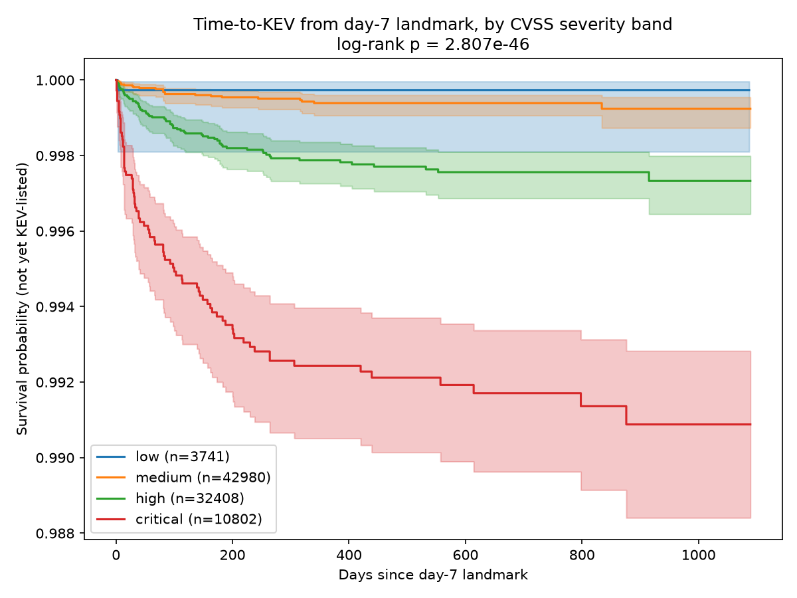
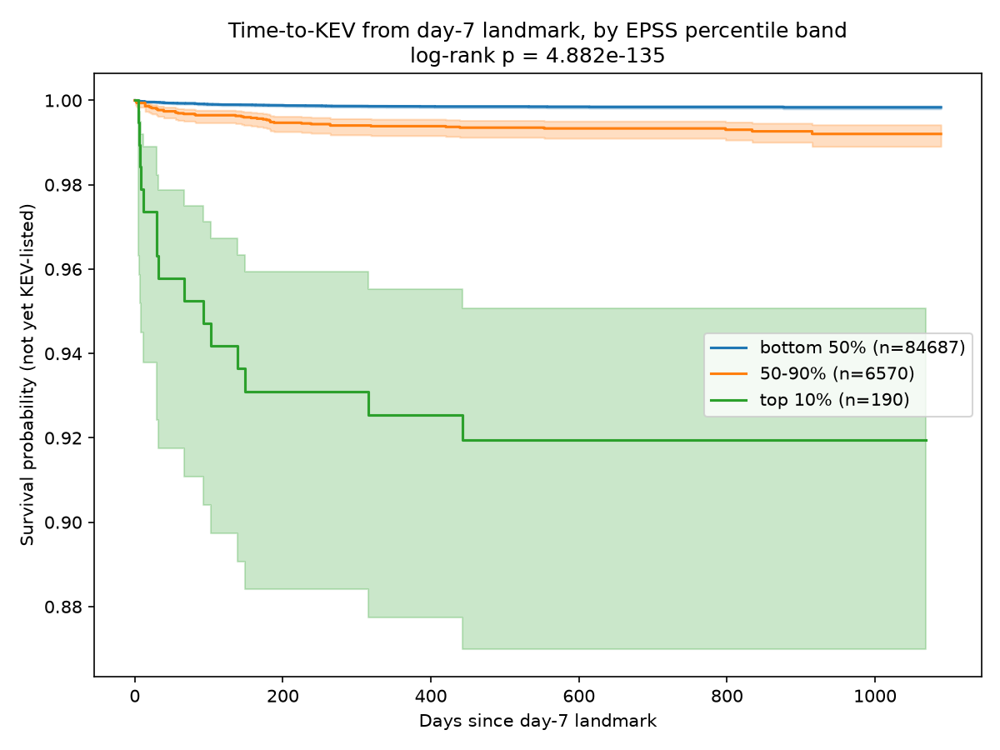
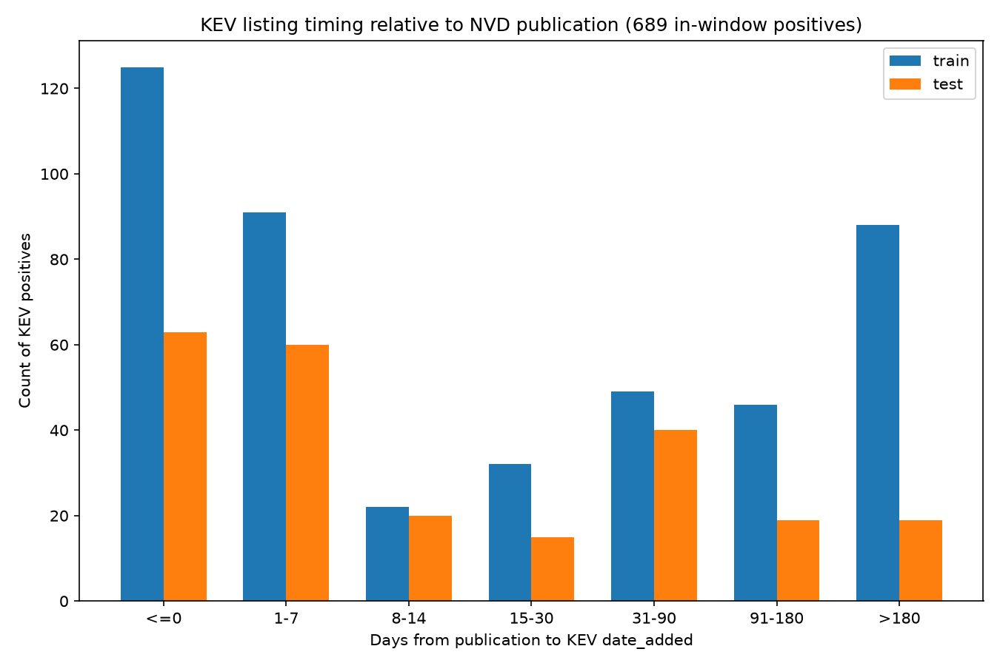
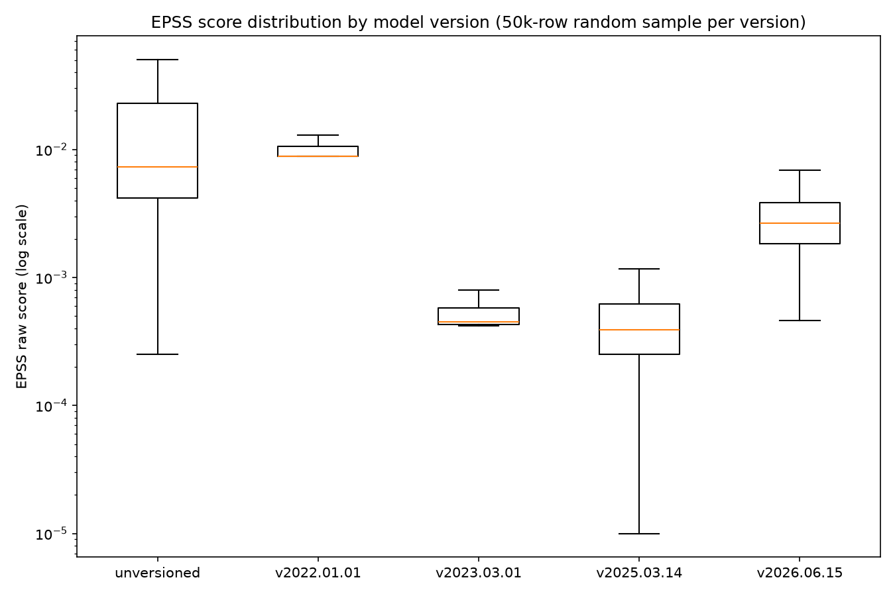

# Exploratory analysis — landmark training data

Generated by `scripts/eda/landmark_eda.py` (one-off, not a pipeline stage).
All numbers below are from `training.training_dataset` / the underlying
canonical tables as of the 2026-09-21 landmark build
(`dataset_version = landmark_v20260921`). Figures in `docs/figures/`.

## Kaplan-Meier: time-to-KEV from the day-7 landmark, training set

### By CVSS severity band

n = 89,931 (day-7 train rows with a CVSS score; 1,516 rows with
`cvss_missing` excluded from this plot). Log-rank test across the 4 bands:
**p = 2.81e-46**.

| Band | n |
|---|---|
| low (<4.0) | 3,741 |
| medium (4.0-6.9) | 42,980 |
| high (7.0-8.9) | 32,408 |
| critical (9.0-10) | 10,802 |

Survival curves separate cleanly and monotonically by severity — critical
CVEs reach ~99.1% survival (i.e. ~0.9% KEV-listed) by ~1000 days post-day-7,
versus ~99.7% for high, ~99.9% for medium/low. The effect is real and in
the expected direction, but the absolute magnitude is small: even
"critical" severity alone predicts KEV-listing for under 1% of CVEs over
nearly 3 years. CVSS severity is a weak standalone signal here, consistent
with it being one covariate among several rather than a strong prior.

### By EPSS percentile band (at the day-7 landmark)

n = 91,447 (no missing — `epss_pct_now` is populated for every day-7 row
by construction). Log-rank test: **p = 4.88e-135** — a far stronger
separation than CVSS.

| Band | n |
|---|---|
| bottom 50% | 84,687 |
| 50-90% | 6,570 |
| top 10% | 190 |

The top-10%-by-EPSS-at-day-7 band (n=190) reaches ~92% survival (~8%
KEV-listed) by ~1000 days — roughly a 40x higher cumulative KEV rate than
the bottom 50% band. EPSS percentile at day 7 is a dramatically stronger
univariate signal than CVSS severity, which is expected (EPSS is
purpose-built for exactly this prediction task) but worth having
confirmed directly against this project's own labels before building
anything on top of it. Note the wide confidence band on the top-10% curve
(only 190 CVEs) — treat the exact survival levels there as noisy even
though the log-rank result is highly significant.

## KEV listing timing relative to publication

Same 689-positive histogram reported earlier in this project's history,
now as a figure. The dominant bars are `<=0` (188 pooled — exploited at or
before public disclosure) and `1-7` (151 pooled) — together 62.1% of all
in-window positives, which is why single-checkpoint day-30 prediction was
abandoned in favor of the landmark (7/14/30) design.

## EPSS score distribution by model version

50,000-row random sample per version (canonical.epss_timeline, log-scale
y-axis, outliers hidden for readability). Visually confirms the ~15x
mean-score shift already found numerically: `v2023.03.01`'s distribution
sits nearly a full order of magnitude below `unversioned`/`v2022.01.01`
and only partially recovers by `v2026.06.15`. This is the same finding
flagged earlier as a risk for treating `epss_model_version_at_asof` as a
simple categorical covariate — visible here directly rather than only in
summary statistics.

## Bottom line for the progress review

- EPSS-at-day-7 is a much stronger univariate KEV predictor than CVSS
  severity in this dataset (p-value ~90 orders of magnitude smaller,
  though p-values at this scale mostly say "yes, real effect" rather than
  quantify how much stronger).
- Both signals are directionally correct and monotonic — no red flags in
  the basic univariate structure of the labels.
- The EPSS model-version shift remains the biggest open modeling risk
  identified so far; it's visible here as a distributional fact, not just
  a summary-statistic artifact.
