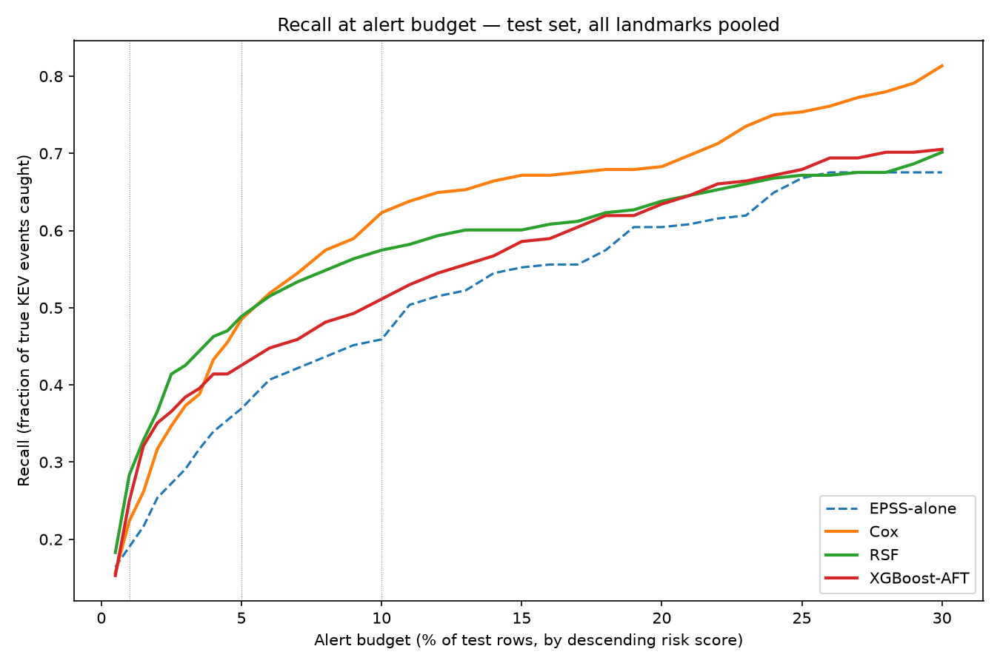
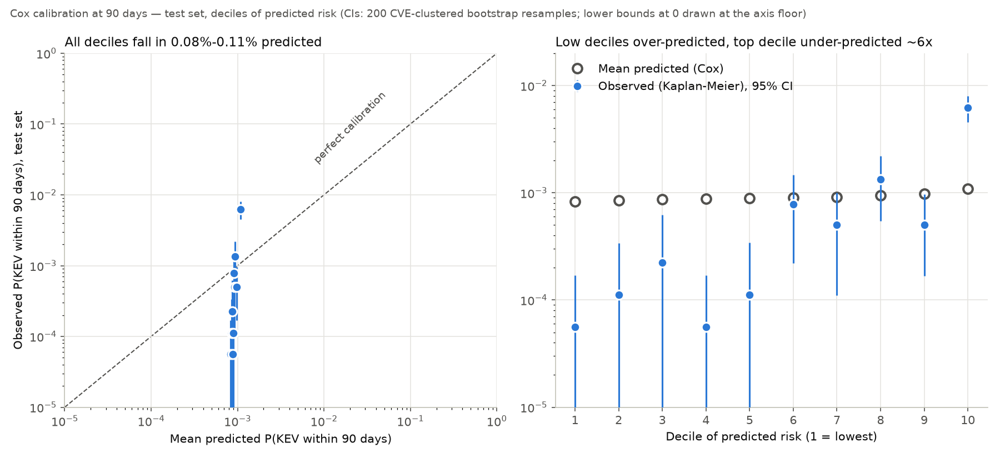

# Model comparison — landmark KEV prediction

> **Computed with the test-time encoding bug.** Every test number in
> this document was computed with an encoding that mis-encoded 84,684 test
> rows (a category given as the training reference category). The tables
> are kept as originally recorded. **Corrected numbers, from the same frozen
> models with nothing refit: [`docs/results_corrected_encoding.md`](results_corrected_encoding.md).**
> No conclusion changed: Cox still leads (C-index 0.850 corrected), and
> XGBoost-AFT vs EPSS is still non-significant.

All numbers below are computed on the SAME test set (published >= 2025-01-01,
178,756 rows / 60,962 CVEs / 268 events) through `scripts/evaluate/common.py`,
using `training.training_dataset` (`dataset_version=landmark_v20260922`,
rebuilt after the CVSS/CWE own-CNA-only source fix — see Limitations). Every
model and EPSS-alone go through the identical bootstrap machinery (same seed,
same CVE-level resampling), so comparisons here are apples-to-apples.

Chosen configs (RSF and XGBoost-AFT tuned on the fit/val split, never on test; their validation inputs
had `epss_model_version_at_asof` mis-encoded, see results_corrected_encoding.md):
- **Cox PH**: penalizer=0.1 (a fixed value, never tuned)
- **RSF**: min_samples_leaf=50, max_features=log2, n_estimators=200, max_samples=20,000
- **XGBoost-AFT**: aft_loss_distribution=extreme, aft_loss_distribution_scale=1.2, max_depth=6, learning_rate=0.05, n_rounds=272

## Final comparison table (95% bootstrap CI, 200 resamples of whole CVEs)

| Model | C-index | Recall@1% | Recall@5% | Recall@10% |
|---|---|---|---|---|
| EPSS-alone | 0.750 (0.695–0.803) | 0.190 (0.131–0.255) | 0.369 (0.277–0.471) | 0.459 (0.374–0.541) |
| Cox | 0.849 (0.813–0.888) | 0.224 (0.144–0.282) | 0.485 (0.398–0.563) | 0.623 (0.528–0.714) |
| RSF | 0.812 (0.773–0.851) | 0.284 (0.221–0.364) | 0.489 (0.417–0.564) | 0.575 (0.507–0.650) |
| XGBoost-AFT | 0.785 (0.732–0.827) | 0.250 (0.175–0.324) | 0.425 (0.329–0.507) | 0.511 (0.412–0.597) |

**Cox is the strongest model on this test set** — not XGBoost-AFT, despite
XGBoost-AFT having the more elaborate tuning process. This reordering only
appeared after the CVSS/CWE source fix (see Limitations): before that fix,
XGBoost-AFT and RSF both scored higher than Cox. With only ~440 training
events, a penalized linear model has less capacity to fit any given
artifact than the flexible tree-based learners do — consistent with Cox's
near-zero change (0.8491→0.8492) across the fix, versus XGBoost-AFT's
0.852→0.785 and RSF's 0.839→0.812 drops (see Limitations).

### Paired comparison vs EPSS-alone (same resamples, difference CI)

| Model | ΔC-index (95% CI) | Excludes 0? | ΔRecall@1% | ΔRecall@5% | ΔRecall@10% |
|---|---|---|---|---|---|
| Cox | +0.100 (0.069, 0.136) | **yes** | +0.026 (−0.027, 0.083) — no | +0.116 (0.060, 0.178) — **yes** | +0.158 (0.085, 0.228) — **yes** |
| RSF | +0.063 (0.005, 0.124) | **yes** | +0.091 (0.036, 0.137) — **yes** | +0.122 (0.024, 0.218) — **yes** | +0.117 (0.017, 0.214) — **yes** |
| XGBoost-AFT | +0.037 (−0.027, 0.099) | no | +0.056 (−0.020, 0.135) — no | +0.057 (−0.042, 0.157) — no | +0.052 (−0.062, 0.164) — no |

Cox and RSF both beat EPSS-alone with CIs excluding zero on C-index and
most recall budgets. **XGBoost-AFT's improvement over EPSS-alone is not
statistically distinguishable from zero at any budget** in this paired
test, despite scoring numerically higher — its CIs are wide because it's
the model whose behavior is most sensitive to which specific CVEs the
resample includes (consistent with the trajectory-ablation finding below).

## Per-landmark C-index (point estimates)

| Landmark | EPSS-alone | Cox | RSF | XGBoost-AFT |
|---|---|---|---|---|
| 7 | 0.761 | 0.857 | 0.812 | 0.765 |
| 14 | 0.766 | 0.857 | 0.816 | 0.792 |
| 30 | 0.714 | 0.830 | 0.806 | 0.845 |

## Trajectory ablation (XGBoost-AFT config fixed, reporting only)

| Feature set | C-index | Recall@10% |
|---|---|---|
| a) Full model | 0.785 | 0.511 |
| b) Minus trajectory features (drop `epss_pct_7d_ago`, `epss_pct_7d_ago_missing`, `epss_pct_delta_7d`, `epss_pct_first`, `epss_pct_max_to_date`, `days_to_first_epss`; keep `epss_pct_now`) | 0.814 | 0.571 |
| c) Minus ALL EPSS features | 0.825 | 0.541 |

Paired (a) − (b), same resamples: ΔC-index = −0.029 (95% CI −0.073, 0.007 —
does not exclude zero), **ΔRecall@10% = −0.059 (95% CI −0.112, −0.007 —
excludes zero)**.

> **Original encoding; never re-run with the corrected encoding.** This
> ablation's status under the corrected encoding is unknown. XGBoost-AFT's
> configuration was also tuned on mis-encoded validation inputs
> ([`results_corrected_encoding.md`](results_corrected_encoding.md)). It is
> not cited as evidence about trajectory features. H1's evidence is the
> corrected Cox ablation below.

Under the original encoding, for this XGBoost-AFT configuration, the
(a) − (b) recall@10% interval excluded zero. One possible explanation is
that six correlated trajectory features give a depth-6 tree spurious split
candidates. RSF's permutation importances rank `cna_kev_rate_expanding`
and `cvss_base_score` far above any EPSS feature. No ablation tested that
explanation, and it is not a finding.

## Cox trajectory ablation (reporting only, same feature sets as above)

> **The table below is original encoding. The corrected result is a null
> result: trajectory features show no measurable benefit.** Re-run with
> the corrected encoding (same feature sets, penalizer and seed; see
> [`results_corrected_encoding.md`](results_corrected_encoding.md#cox-trajectory-ablation-corrected)),
> (a) − (b) ΔC-index is −0.0055, 95% CI [−0.0147, +0.0049], which spans
> zero. Full Cox leads at recall@10% (0.631 vs 0.616). Full Cox also beats
> Cox-without-any-EPSS at recall@10% (+0.075, CI excludes zero): EPSS's
> current level carries signal, and its trajectory adds nothing measurable
> on top. This is the evidence for rejecting H1 (`docs/STATUS.md`).

| Feature set | C-index | Recall@5% | Recall@10% |
|---|---|---|---|
| a) Full Cox | 0.8492 | 0.4851 | 0.6231 |
| b) Minus trajectory features (same 6 dropped as XGBoost above) | 0.8600 | 0.5149 | 0.5970 |
| c) Minus ALL EPSS features | 0.8379 | 0.4179 | 0.5709 |

Paired (a) − (b), same 200 resamples: **ΔC-index = −0.0107 (95% CI −0.0196,
−0.0012 — excludes zero)**, ΔRecall@5% = −0.0299 (95% CI −0.0948, 0.0236 —
no), ΔRecall@10% = +0.0261 (95% CI −0.0217, 0.0755 — no).
Paired (a) − (c): ΔC-index = +0.0114 (95% CI −0.0190, 0.0395 — no).

The 6 trajectory features dropped in (b) are `epss_pct_7d_ago`, `epss_pct_7d_ago_missing`, `epss_pct_delta_7d`, `epss_pct_first`, `epss_pct_max_to_date`, `days_to_first_epss`.
Under the original encoding the (a) − (b) C-index interval above excluded
zero. That was an artifact of the test-encoding bug: under the corrected
encoding it spans zero. The original reading of this table, and the
explanation built on it, have been withdrawn. The supported statement is
the null result in the note above.

## Blind-spot catch rate at 10% budget

Among test positives that EPSS-alone does NOT place in its own top 10%
(i.e., cases EPSS misses), what fraction does each model catch in *its*
top 10%:

| Model | Catch rate (95% CI) |
|---|---|
| Cox | 0.310 (0.176, 0.426) |
| RSF | 0.352 (0.248, 0.488) |
| **XGBoost-AFT** | **0.421 (0.283, 0.535)** |

Interesting reversal from the headline table: **XGBoost-AFT catches the
largest share of EPSS's specific blind spots**, even though its overall
C-index/recall are the weakest of the three. This is plausibly the same
mechanism as the trajectory-ablation finding — non-EPSS signal
(`cna_kev_rate_expanding`, CVSS) is what catches EPSS's misses, and
XGBoost-AFT's tree structure leans on that signal most heavily (at some
cost to overall recall from EPSS-trajectory noise). Worth keeping in mind
if the actual goal is specifically closing EPSS's blind spots rather than
maximizing pooled recall.

## RSF run-to-run variance

Same config (`min_samples_leaf=50, max_features=log2`), 3 different
`random_state` values, refit from scratch each time:

| random_state | Test C-index |
|---|---|
| 0 | 0.8122 |
| 1 | 0.8150 |
| 2 | 0.8184 |

Spread = 0.0062, std = 0.0025. Small relative to the ~0.04–0.10 gaps between
models in the headline table, but real — RSF's own tuning-time config
selection was also observed to be non-reproducible across runs (see
Limitations). Any RSF number in this document should be read as "≈0.81 ±
0.01," not a fixed point value.

## Post-freeze secondary metrics: time-dependent AUC, Brier score, calibration

> Original encoding. Corrected time-dependent AUC, Brier, IPA and
> calibration: [`results_corrected_encoding.md`](results_corrected_encoding.md).

**These were computed after the models were frozen (commit f0a07b2) and did
not influence model selection, tuning, or features.** They use the frozen
files in `models/` as-is. Before reporting, the script checks that each
loaded model reproduces the test C-index in its metadata to 1e-9.
Everything runs through `scripts/evaluate/common.py`, with the same test
rows, seed (20260922) and 200 whole-CVE bootstrap resamples as every table
above. Script: `python -m scripts.evaluate.post_freeze_metrics`.

**EPSS reference:** this section uses the **raw** EPSS score
(`epss_score_at_asof_raw`, as `docs/evaluation_plan.md` specifies). The
tables above use `epss_pct_now`. On test the two give nearly the same
C-index (0.748 raw vs 0.750 percentile).

### Time-dependent AUC (cumulative/dynamic, sksurv)

- **Horizons:** 30, 90 and 180 days after each row's `as_of_date`.
- **Censoring weights:** estimated from the training survival data.
- **Range check:** all horizons are in range. Test follow-up is 1–620
  days, and the longest test time (620) is within the training follow-up
  (1–1089 days). No resample was dropped.

Pooled, 95% CI:

| Model | AUC(30d) | AUC(90d) | AUC(180d) |
|---|---|---|---|
| EPSS raw | 0.736 (0.668–0.808) | 0.736 (0.663–0.802) | 0.734 (0.670–0.798) |
| **Cox** | **0.847 (0.786–0.897)** | **0.846 (0.799–0.888)** | **0.850 (0.805–0.889)** |
| RSF | 0.825 (0.749–0.872) | 0.817 (0.755–0.864) | 0.820 (0.765–0.865) |
| XGBoost-AFT | 0.752 (0.683–0.812) | 0.776 (0.710–0.831) | 0.788 (0.731–0.830) |

Paired difference vs EPSS raw on the same resamples (✓ = 95% CI excludes 0):

| Model | ΔAUC(30d) | ΔAUC(90d) | ΔAUC(180d) |
|---|---|---|---|
| Cox | +0.111 (0.065, 0.165) ✓ | +0.110 (0.070, 0.155) ✓ | +0.115 (0.080, 0.160) ✓ |
| RSF | +0.089 (0.010, 0.166) ✓ | +0.082 (0.017, 0.155) ✓ | +0.086 (0.032, 0.150) ✓ |
| XGBoost-AFT | +0.016 (−0.059, 0.098) | +0.041 (−0.039, 0.121) | +0.054 (−0.013, 0.122) |

Per landmark (point estimate; 95% CI in brackets for the paired Δ vs EPSS):

| Landmark | Horizon | EPSS raw | Cox (Δ) | RSF (Δ) | XGBoost-AFT (Δ) |
|---|---|---|---|---|---|
| 7 | 30d | 0.787 | 0.879 (+0.092 [0.049, 0.144] ✓) | 0.824 (+0.037 [−0.043, 0.114]) | 0.758 (−0.029 [−0.134, 0.091]) |
| 7 | 90d | 0.766 | 0.865 (+0.099 [0.063, 0.139] ✓) | 0.817 (+0.051 [−0.019, 0.133]) | 0.749 (−0.018 [−0.122, 0.088]) |
| 7 | 180d | 0.749 | 0.859 (+0.110 [0.076, 0.146] ✓) | 0.819 (+0.070 [0.008, 0.136] ✓) | 0.771 (+0.022 [−0.060, 0.118]) |
| 14 | 30d | 0.770 | 0.865 (+0.095 [0.040, 0.159] ✓) | 0.840 (+0.071 [−0.040, 0.168]) | 0.774 (+0.004 [−0.160, 0.134]) |
| 14 | 90d | 0.748 | 0.853 (+0.105 [0.060, 0.155] ✓) | 0.827 (+0.079 [−0.002, 0.148]) | 0.788 (+0.041 [−0.056, 0.149]) |
| 14 | 180d | 0.748 | 0.853 (+0.105 [0.064, 0.150] ✓) | 0.820 (+0.072 [0.000, 0.147] ✓) | 0.795 (+0.047 [−0.044, 0.145]) |
| 30 | 30d | 0.615 | 0.777 (+0.162 [0.085, 0.247] ✓) | 0.809 (+0.194 [0.058, 0.337] ✓) | 0.821 (+0.206 [0.078, 0.322] ✓) |
| 30 | 90d | 0.673 | 0.809 (+0.136 [0.075, 0.196] ✓) | 0.803 (+0.130 [0.032, 0.232] ✓) | 0.833 (+0.161 [0.073, 0.243] ✓) |
| 30 | 180d | 0.695 | 0.832 (+0.137 [0.087, 0.196] ✓) | 0.818 (+0.123 [0.043, 0.213] ✓) | 0.853 (+0.158 [0.082, 0.231] ✓) |

What the AUC results show:

- **The AUC ranking matches the C-index ranking:** Cox > RSF > XGBoost-AFT >
  EPSS.
- **Cox beats EPSS significantly** at every horizon, pooled and at every
  landmark.
- **XGBoost-AFT beats EPSS significantly only at landmark 30.** That is
  where EPSS is weakest (AUC(30d) 0.615), and it matches XGBoost-AFT's
  per-landmark C-index pattern above.
- **Sanity check passed:** no model's AUC is well above its C-index (Cox
  0.846–0.850 vs C 0.849; RSF 0.817–0.825 vs 0.812; XGBoost-AFT 0.752–0.788
  vs 0.785).
- **Censoring-weight sensitivity:** re-estimating the censoring weights
  from test instead of train moves every pooled AUC by at most 0.002 (Cox
  0.847/0.846/0.849), and Cox's IBS from 0.00104 to 0.00098. The IPCW
  weighting is not driving these numbers.

### Brier score (Cox only)

**Method:**

- IPCW Brier score at 30, 90 and 180 days, and the integrated Brier score
  (IBS) over 30–180 days on a daily grid.
- The Brier score is near zero for every model here, because the event is
  rare: about 0.1% of rows by 90 days. So each Brier value is paired with
  a **reference**: the training Kaplan-Meier curve, i.e. the same base-rate
  prediction for every row.
- The comparison uses the index of prediction accuracy,
  IPA = 1 − BS_Cox / BS_reference, computed on each resample. IPA > 0 means
  the model beats knowing only the base rate.

| | Cox | Reference (train KM) | IPA (95% CI) |
|---|---|---|---|
| Brier 30d | 0.000558 | 0.000558 | 0.00015 (0.00011–0.00020) |
| Brier 90d | 0.001037 | 0.001038 | 0.00031 (0.00025–0.00039) |
| Brier 180d | 0.001325 | 0.001326 | 0.00049 (0.00039–0.00059) |
| IBS 30–180d | 0.001036 (0.000835–0.001268) | 0.001037 | 0.00035 (0.00027–0.00042) |

**Cox's Brier score is essentially the base rate's.** The IPA is
significantly above zero but tiny, about 0.03%. The near-zero Brier value
comes from event rarity, not from good predictions. The calibration results
below explain why.

**No EPSS Brier score.** The raw EPSS score is a probability of observed
exploitation activity in the next 30 days. It is not a probability of KEV
listing, and it says nothing about 90 or 180 days. Any mapping to
P(KEV by t) would be a new fitted model, not EPSS, so this section doesn't
invent one.

### Calibration at 90 days (Cox)

**Method:** test rows are split into deciles of predicted
P(KEV within 90 days) = 1 − S(90|x). In each decile, the mean prediction is
compared with the Kaplan-Meier observed rate. Observed-rate CIs come from
the same CVE-clustered bootstrap.

| Decile | Predicted range | Mean predicted | Observed (95% CI) | Events ≤90d | Predicted / observed |
|---|---|---|---|---|---|
| 1 | 0.078–0.084% | 0.083% | 0.006% (0–0.017%) | 1 | 14.8 |
| 2 | 0.084–0.086% | 0.085% | 0.011% (0–0.034%) | 2 | 7.6 |
| 3 | 0.086–0.088% | 0.087% | 0.022% (0–0.062%) | 4 | 3.9 |
| 4 | 0.088–0.089% | 0.088% | 0.006% (0–0.017%) | 1 | 15.7 |
| 5 | 0.089–0.090% | 0.089% | 0.011% (0–0.034%) | 2 | 8.0 |
| 6 | 0.090–0.091% | 0.090% | 0.078% (0.022–0.146%) | 14 | 1.2 |
| 7 | 0.091–0.093% | 0.092% | 0.050% (0.011–0.101%) | 9 | 1.8 |
| 8 | 0.093–0.096% | 0.094% | 0.134% (0.055–0.221%) | 24 | 0.7 |
| 9 | 0.096–0.101% | 0.098% | 0.050% (0.017–0.096%) | 9 | 1.9 |
| 10 | 0.101–0.184% | 0.109% | 0.621% (0.455–0.801%) | 111 | 0.18 |
| All | — | 0.092% | 0.099% (0.078–0.121%) | 177 | 0.92 |

**Verdict: calibrated on average, but badly under-dispersed.** Cox's
probabilities are too compressed toward the base rate, i.e.
*under-confident* at both ends:

- **Overall level is right.** Mean predicted 0.092% vs observed 0.099%
  (ratio 0.92, inside the observed CI).
- **The predictions barely vary.** Across all 178,756 test rows the
  predicted 90-day probability spans only 0.078%–0.184%. The partial
  hazards span a 2.4× range, from lowest to highest.
- **High-risk rows are under-predicted.** The top decile holds 111 of
  the 177 events by 90 days. It is predicted at 0.11% but observed at 0.62%,
  about 6× too low.
- **Low-risk rows are over-predicted.** Deciles 1–5 are predicted at about
  0.085% and observed at 0.006–0.022%.

The ranking is still good (C-index 0.849, AUC 0.85), because a Cox model's
ranking depends only on the order of its linear predictor, not its spread.
The penalizer (0.1) was never tuned. It was a fixed value set in the first
preliminary Cox baseline (`5233885`, "untuned CoxPHFitter
(penalizer=0.1)"), before the fit/validation split existed, and it was
kept unchanged since. (An earlier version of this sentence said it was
"chosen on C-index"; the history doesn't support that.) No probability-scale
criterion was ever applied, so nothing in model development would have
noticed the compression.

**Consequence for the planned fuzzy layer:** it will inherit these
compressed probabilities if it consumes 1 − S(t|x) from the frozen Cox
directly. A fuzzy rule on a probability that ranges from 0.08% to 0.18%
cannot separate "watch" from "act" on the probability's own scale. One of
these would be needed first:

- recalibrate on fit/val only, never on test (e.g. isotonic or Platt-style
  on validation);
- feed the fuzzy layer rank or percentile of risk instead of raw
  probability;
- revisit the penalizer against a probability-scale criterion (Brier/IPA
  on validation).

That decision is outside this reporting-only step, and nothing here changes
the frozen model.

### XGBoost-AFT C-index vs EPSS (outstanding item, resolved)

**Confirmed: the interval does not exclude zero.** Re-running
`paired_bootstrap_compare` on the frozen XGBoost-AFT reproduces the table
above exactly:

- **vs `epss_pct_now`:** point Δ = +0.035 (bootstrap mean +0.037), 95% CI
  (−0.027, +0.099). The "+0.037" in the paired table above is the bootstrap
  mean.
- **vs raw EPSS:** Δ = +0.037, 95% CI (−0.019, +0.099).

XGBoost-AFT's C-index gain over EPSS is **not statistically
distinguishable from zero** at the 95% level. The same holds for its pooled
time-dependent AUC gain at every horizon.

## Limitations

- **CVSS/CWE source fix, applied this session**: the original "CNA-sourced"
  filter accepted any metric with `source != nvd@nist.gov`, which
  (unintentionally) admitted CISA's own ADP (Vulnrichment) contributions —
  confirmed via raw payload inspection that source
  `134c704f-9b21-4f2e-91b3-4a467353bcc0` carries
  `ssvcData.role="CISA Coordinator"`. Since CISA runs KEV, CISA choosing to
  enrich a CVE with its own CVSS/CWE is a direct circularity with the label.
  The rule is now "source equals the CVE's own `sourceIdentifier`" (its
  actual reporting CNA). This removed ~18% of accepted CVSS metrics and ~20%
  of accepted CWE mappings and dropped every model's test C-index
  meaningfully (XGBoost-AFT: 0.852→0.785; RSF: 0.839→0.812; Cox: 0.8491→0.8492,
  essentially unaffected — with only ~440 training events, a penalized
  linear model has less capacity to fit the removed artifact in the first
  place than the flexible tree-based learners do, so it had less to lose
  when that artifact was removed). All numbers in this document are
  post-fix.
- **Validation-vs-test bias asymmetry, not fully resolved**: even after the
  fix, CVSS-presence still correlates with the label — positives are less
  likely to be missing a CVSS score than negatives, by 2.8pp on train and
  6.2pp on test (both now under the pre-fix 20.9pp/6.0pp gaps, but not
  zero). Because the gap is larger in the earlier (fit/val) era than in the
  test era, validation-set model selection somewhat over-credits this
  residual signal relative to what test shows — treat validation C-index as
  optimistic versus test, always report test numbers as the real answer.
- **`disclosure@vulncheck.com` as a CNA**: this source has the highest
  positive rate (6.5%) among the top-20 CNAs by positive count in train
  (n=46 CVEs, 3 positives). VulnCheck is a vulnerability-intelligence vendor
  whose business is specifically tracking exploited vulnerabilities — CNA
  assignment under that identifier plausibly correlates with "already known
  to be interesting" at the time of CNA assignment. This is different from
  the CISA case: VulnCheck's CVSS/CWE, if assigned before or independent of
  its KEV date, is legitimate publication-time information (a CNA's
  professional judgment about severity, not the KEV-deciding body scoring
  its own future decision) — but it's flagged here because the *n* is small
  and the mechanism (a threat-intel firm as CNA) is different enough from
  ordinary vendor PSIRTs to warrant a closer look before leaning on
  `cna_kev_rate_expanding` without caveat.
- **RSF non-determinism**: despite `random_state=0`, sksurv's
  `RandomSurvivalForest` under `n_jobs=-1` picked a *different* winning
  hyperparameter configuration across two otherwise-identical tuning runs on
  the same data, and test C-index varies by up to 0.0062 across
  `random_state` values at a fixed config (see above). Any RSF result in
  this project should be treated as approximate, not a fixed reproducible
  number, unless `n_jobs=1` is used (untested here, would be much slower).
